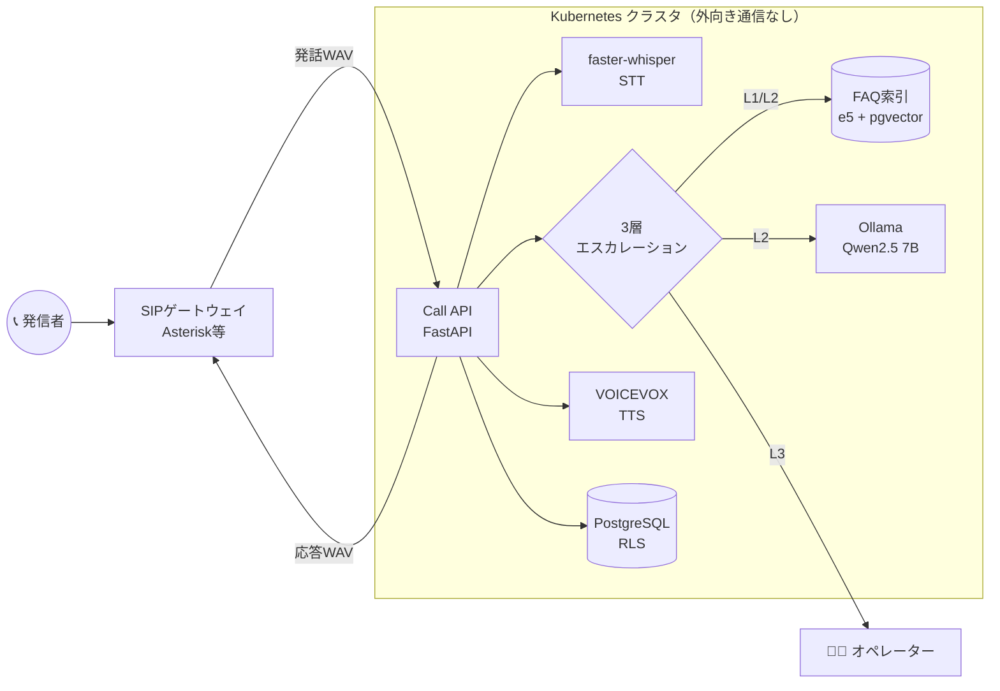
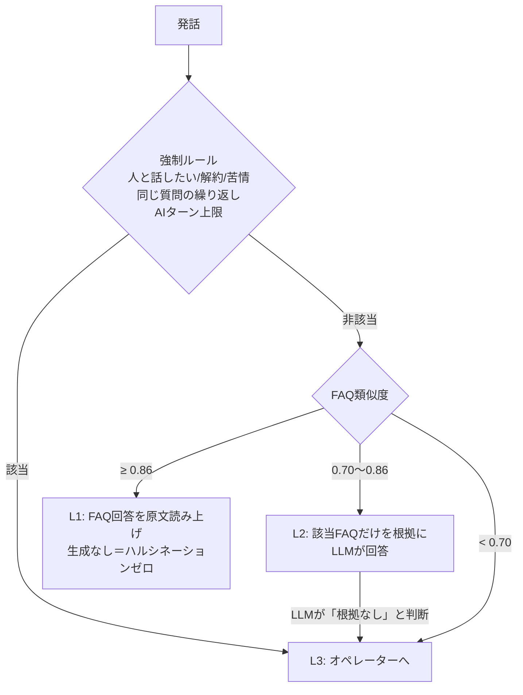
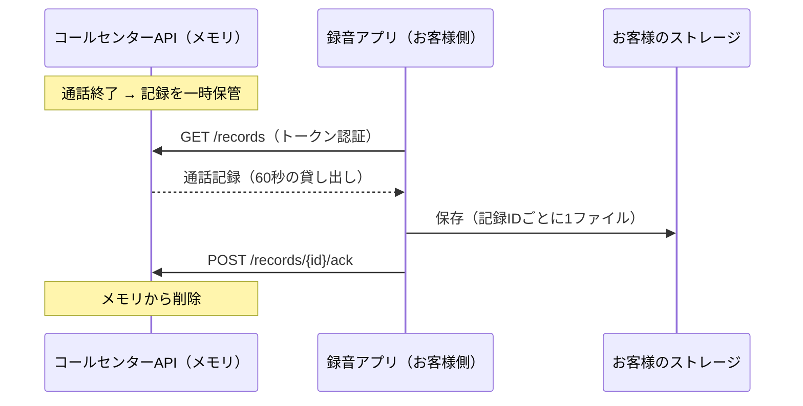

# AI Call Center with Ollama

**外部クラウドAIを一切使わない、自社完結型のAIコールセンター基盤（プロトタイプ）**

電話の音声を文字起こし → FAQ検索と社内LLMで回答 → 音声合成で応答し、AIで解決できない問い合わせは確実にオペレーターへ引き継ぎます。通話音声・会話内容が社外に出ないため、医療・金融・自治体など**データ主権が求められる業種**を想定しています。

> English: A self-hosted voice-bot platform for call centers. faster-whisper (STT) + Ollama (LLM) + VOICEVOX (TTS), RAG over tenant FAQs with multilingual-e5, a 3-layer escalation policy, PostgreSQL row-level-security multi-tenancy, and a Helm chart with NetworkPolicies that keep all AI traffic inside the cluster.

---

## 特長

| | 内容 | 実装 |
|---|---|---|
| 🔒 データ主権 | AIエンドポイントが外部を向いていると**起動を拒否**。K8s NetworkPolicyでモデルサーバーの外向き通信を遮断 | `config.py` / `networkpolicy.yaml` |
| 🧭 3層エスカレーション | ① FAQ原文読み上げ → ② FAQ根拠付きLLM回答 → ③ 有人対応。「人と話したい」「解約」等は即座に有人へ | `escalation.py` |
| 💬 続きの質問 | 直前の発話と合わせてFAQを検索し、直近の会話をLLMに渡すので「それは無料ですか」にも答えられる。前の話題のFAQを原文で読み上げることはしない | `escalation.py` |
| 📝 引き継ぎ要約 | 有人へ回すとき、用件の要約・エスカレーション理由・会話記録をオペレーター向けにまとめる。応答を返した後に生成するので発信者を待たせず、LLM失敗時も定型の要約で引き継ぐ。長い数字（カード番号等）は自動で伏せる | `handoff.py` / `GET .../handoff` |
| 🧹 会話データを残さない | 会話は通話中のメモリ上だけに置き、通話終了で破棄。放置された通話（既定10分）と未確認の引き継ぎ要約（既定30分）も自動で消える | `api.py` |
| 🗄️ 会話記録はお客様のストレージへ | お客様側に置く録音アプリが取りに来たときだけ通話記録を渡し、保存の確認（ACK）を受けたらメモリから削除。こちらはお客様のストレージの認証情報を一切持たない | `records.py` / `recorder/` |
| 📚 RAG FAQ | multilingual-e5（`query:` / `passage:` プレフィックス対応）でテナントごとに独立した索引 | `rag.py` |
| 🏢 マルチテナント | テナント単位の索引・セッション分離＋PostgreSQL RLSで他社データ参照を構造的に防止 | `tenants.py` / `db/schema.sql` |
| ⏱️ レイテンシ計測 | STT / 判定 / TTS の段階別ミリ秒をターンごとに記録、Prometheus形式で出力 | `pipeline.py` / `/metrics` |
| 💴 キャパシティ・コスト試算 | Erlang C でオペレーター数、同時通話数からGPU台数を算出し、1通話あたりコストを試算 | `cost_model.py` |

## アーキテクチャ



### 3層エスカレーションの判定順



設計上のポイント：
- **強制ルールを最優先**：FAQの一致度が高くても「人と話したい」と言った人をAIに留めない
- **L1は生成しない**：確度が高いときはLLMを通さず原文を読むので、誤回答リスクと遅延の両方を削減
- **続きの質問はL2で扱う**：「それは？」のように話題を含まない発話は、直前の発話と合わせて検索し、会話履歴付きでLLMが回答する。L1の原文読み上げは今の発話単体で一致したときだけ（`MAX_HISTORY_TURNS=0` で無効化）
- **L2は「わからない」と言える**：参考情報で答えられない場合は番兵文字列を返させ、推測回答を防止

## クイックスタート

```bash
# 1. 依存サービスを起動（Ollama / VOICEVOX / PostgreSQL / API）
cp .env.example .env
docker compose up -d
docker compose exec ollama ollama pull qwen2.5:7b-instruct

# 2. 通話を開始してテキストで1ターン試す
CALL=$(curl -s -X POST localhost:8000/v1/tenants/demo-clinic/calls | jq -r .call_id)
curl -s -X POST localhost:8000/v1/tenants/demo-clinic/calls/$CALL/text \
  -H 'Content-Type: application/json' -d '{"text":"駐車場はありますか"}' | jq

# 3. 音声で1ターン（応答はWAVで返る）
curl -s -X POST localhost:8000/v1/tenants/demo-clinic/calls/$CALL/audio \
  -F file=@question.wav -o reply.wav -D -
```

応答例：

```json
{
  "transcript": "駐車場はありますか",
  "reply": "建物の裏手に5台分の無料駐車場がございます。…",
  "layer": 1,
  "reason": "faq score 0.93",
  "sources": ["access-01"],
  "latency_ms": {"policy": 41.2, "tts": 310.5}
}
```

### オペレーターへの引き継ぎ要約

有人対応（layer 3）になったターンの応答には `handoff_url` が入ります（音声ターンでは `X-Handoff-Url` ヘッダー）。オペレーター画面はこのURLを取得します。

```bash
curl -s localhost:8000/v1/tenants/demo-clinic/calls/$CALL/handoff | jq
```

```json
{
  "status": "ready",
  "summary": "駐車場の有無を確認したうえで、解約を希望されています。",
  "reason": "hard rule matched: 解約",
  "last_utterance": "解約したいです",
  "transcript": [{"role": "caller", "text": "駐車場はありますか"}, {"role": "ai", "text": "建物の裏手に…"}],
  "faq_sources": ["access-01"],
  "generated_by": "llm"
}
```

要約の生成中は `{"status": "pending"}` が返ります。

### 通話の終了と会話データの破棄

```bash
# 電話ゲートウェイが切断・転送時に呼ぶ（会話はここで破棄）
curl -s -X DELETE localhost:8000/v1/tenants/demo-clinic/calls/$CALL | jq
# {"call_id": "...", "turns": 2, "final_layer": 3, "handoff_pending": true}

# オペレーターが要約を確認したら破棄
curl -s -X DELETE localhost:8000/v1/tenants/demo-clinic/calls/$CALL/handoff
```

引き継ぎ要約は通話終了後もオペレーターが確認するまで残ります。どちらも `CALL_IDLE_TIMEOUT_S`（既定600秒）・`HANDOFF_TTL_S`（既定1800秒）を過ぎると自動で破棄され、件数は `/metrics` の `callcenter_active_calls` / `callcenter_pending_handoffs` で確認できます。

### 会話記録をお客様側のストレージに残す

会話記録は、お客様の環境にインストールする**録音アプリ（`recorder/`）**が取りに来たときだけ渡します。こちらからお客様のストレージへ書き込むことはなく、その認証情報も持ちません。



#### 録音アプリはどうやって本機を見つけるか

録音アプリは本機を自動で探しません。本機が起動時に**自分の接続情報を記録**し、それを埋め込んだ録音アプリ一式を管理者がダウンロードしてお客様に渡します。

```bash
# 本機の設定（.env）
PUBLIC_URL=https://callcenter.example.com     # 録音アプリの接続先
ADMIN_TOKEN_SHA256=<管理者トークンのsha256>    # 未設定なら管理APIは無効
STATE_DIR=state                               # 記録と発行済みトークンの保存先

# 起動時に state/deployment.json へ記録される（管理者のみ参照可）
curl -s -H "Authorization: Bearer $ADMIN" localhost:8000/v1/admin/deployment | jq

# お客様用の一式を発行（新しいトークンを発行し、古いトークンは無効になる）
curl -s -X POST -H "Authorization: Bearer $ADMIN" \
  localhost:8000/v1/admin/tenants/demo-clinic/recorder-bundle -o recorder-demo-clinic.zip
```

| 記録する情報 | 本機の記録（管理者のみ） | お客様に渡す一式 |
|---|---|---|
| 公開URL・DNS名・ポート | ✅ | ✅ |
| 名前解決したIP（ファイアウォールの許可用） | ✅ | ✅ |
| プライベートCAの証明書（`PUBLIC_CA_FILE`） | ✅ | ✅ |
| 録音アプリ用トークン | ハッシュのみ | ✅（この一式にだけ含まれる） |
| 作業ディレクトリ・待ち受けアドレス・実行ユーザー/UID・書き込み権限 | ✅ | ❌ 渡さない |

内部構成はお客様側に渡すと攻撃の手がかりになるため、一式には接続に必要な情報だけを入れています。

一式の中身（`recorder/`）：

```
recorder.py          録音アプリ本体
Dockerfile           コンテナ用
docker-compose.yml   そのまま起動できる構成（保存先 /srv/call-records）
recorder.env         接続先URL・テナント・トークン（設定済み）
connection.json      接続先・ポート・IPを機械可読で
CONNECTION.md        許可する通信・必要な権限の説明
ca.pem               プライベートCAの場合のみ
```

お客様の環境では、展開して接続確認をしてから起動します。

```bash
unzip recorder-demo-clinic.zip && cd recorder
sudo mkdir -p /srv/call-records && sudo chown 10001:10001 /srv/call-records
docker compose run --rm recorder --check   # DNS → TCP → TLS+認証を順に確認、記録は取らない
# [OK] DNS       callcenter.example.com -> 203.0.113.10
# [OK] TCP       callcenter.example.com:443 reachable
# [OK] TLS+AUTH  server 0.1.0
docker compose up -d
```

S3互換ストレージに保存する場合は `recorder.env` の `RECORDER_STORAGE=s3://bucket/prefix` に変えます（MinIO等は `RECORDER_S3_ENDPOINT` も設定）。

- **確実に届ける**：ACKが来ない記録は60秒後（`RECORD_LEASE_S`）に再送。録音アプリは記録IDで重複を防ぐ
- **抱え込まない**：取りに来ないまま24時間（`RECORD_TTL_S`）過ぎた記録や、1テナント1,000件を超えた古い記録は破棄し、`callcenter_records_dropped_total` で検知できる
- 記録の中身：通話の開始・終了時刻、各ターンの発話と応答、層、理由、参照FAQ、処理時間、引き継ぎ要約。8桁以上の数字は伏せ字
- 録音を有効にしていないテナントでは、記録自体を作らない

### 実機での通し確認（スモークテスト）

1台のPC（CPUのみで可）で一式を起動し、通話1本で全機能を順に確認します。

```bash
scripts/smoke.sh                                  # 既定は軽い qwen2.5:3b-instruct
SMOKE_MODEL=qwen2.5:7b-instruct scripts/smoke.sh  # 本番相当のモデルで
SMOKE_KEEP=1 scripts/smoke.sh                     # 終了後もコンテナを残す
```

起動済みのAPIに対して確認だけ流すこともできます：`python scripts/smoke.py --url http://localhost:8000 [--admin-token TOKEN]`

確認する流れ：L1 → 続きの質問 → 言い換え（L2）→ 強制ルールで有人化 → 引き継ぎ要約と番号の伏せ字 → 音声の往復（VOICEVOXで作った音声をWhisperで聞き取る）→ 通話終了と破棄 → メトリクス → 録音アプリ一式の発行 → `--check` → 記録の保存とACK後の削除

結果は `PASS` / `WARN` / `FAIL` で表示します。`WARN` はモデルの賢さに左右される項目（小さいモデルで続きの質問を解釈できない等）で、仕組みの不具合ではありません。`FAIL` が1つでもあれば終了コード1になります。

### Kubernetes へのデプロイ

```bash
helm install cc deploy/helm/callcenter \
  --set ollama.model=qwen2.5:7b-instruct \
  --set api.replicas=3
```

GPUノード（`nvidia.com/gpu`）にOllamaを配置し、APIはHPAでCPU使用率に応じて2〜8台に自動スケールします。

## テスト

GPUやモデルなしで、通話フロー全体を数百ミリ秒で検証できるようにしています。STT/LLM/TTS/埋め込みはProtocolで抽象化し、テストでは決定的に動くダミーに差し替えています。

```bash
pip install -e ".[dev]"
pytest -q        # 71 tests
ruff check .
```

| テスト | 検証内容 |
|---|---|
| `test_escalation.py` | 各層への振り分け、強制ルールの優先、LLMの回答拒否、繰り返し・ターン上限での有人化、続きの質問・履歴の上限・通話間で履歴が混ざらないこと |
| `test_api.py` | テキスト/音声ターン、**テナント間でセッション・FAQが漏れないこと**、入力検証、メトリクス |
| `test_handoff.py` | 引き継ぎ要約の内容、LLM失敗時の代替要約、番号の伏せ字、テナント間で要約が見えないこと |
| `test_lifecycle.py` | 通話終了で会話が消えること、要約は確認まで残ること、放置通話と要約の期限切れ、他テナントから操作できないこと |
| `test_records.py` | 記録の作成・取得・ACKでの削除、再送、期限切れと上限、トークン認証、録音アプリの保存と重複防止、保存失敗時にACKしないこと |
| `test_bundle.py` | 起動時の記録、一式の中身、内部情報を含まないこと、再発行で古いトークンが無効になること、管理APIの認証、接続確認（`--check`） |
| `test_rag.py` | e5プレフィックス付与、類似度順の検索 |
| `test_cost_model_and_config.py` | Erlang Cの既知値、AI解決率とコストの関係、外部エンドポイント検出 |

## キャパシティ試算の例

```python
from callcenter.cost_model import Workload, estimate

estimate(Workload(peak_calls_per_hour=120, ai_resolution_rate=0.6))
# Estimate(gpus=2, operators=8, monthly_cost_jpy=3040000, monthly_calls=17640, cost_per_call_jpy=172.3)
```

AI解決率を30%→80%に改善した場合のオペレーター削減数とコスト差を、営業・導入提案の段階で数値で示せます。

## ディレクトリ構成

```
src/callcenter/
  adapters.py     STT / LLM / TTS クライアント（Protocolで差し替え可能）
  rag.py          FAQ読み込みとベクトル検索
  escalation.py   3層エスカレーション判定
  handoff.py      オペレーター向け引き継ぎ要約
  records.py      お客様側へ渡す通話記録の一時保管とトークン
  deployment.py   起動時の自己記録と録音アプリ一式の生成
  pipeline.py     音声1ターンの処理とレイテンシ計測
  tenants.py      テナント管理
  api.py          FastAPI エンドポイント
  cost_model.py   Erlang C ベースの体制・コスト試算
  config.py       環境変数とデータ主権ガード
db/schema.sql     マルチテナントスキーマ（pgvector + RLS）
recorder/         お客様側に置く録音アプリ（ディレクトリ / S3互換に保存）
deploy/helm/      Helm チャート（HPA・NetworkPolicy含む）
data/faq/         テナント別FAQ（サンプル: demo-clinic）
```

## 今後の拡張

- ストリーミングSTT／TTSによる応答開始までの遅延短縮（目標 < 1.5秒）
- 引き継ぎ要約を表示するオペレーター画面（APIは実装済み）
- FAQ未回答ログからの改善候補の自動抽出

## License

MIT
