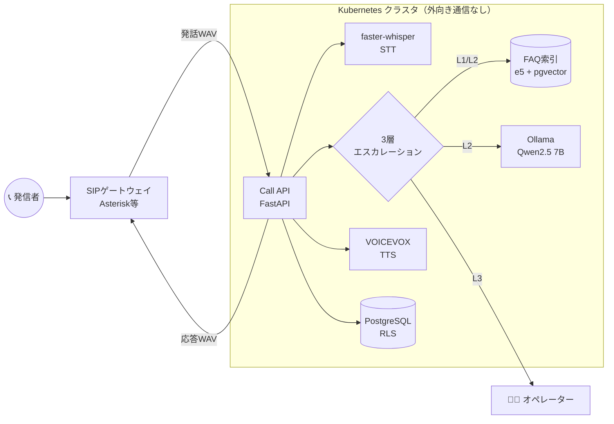
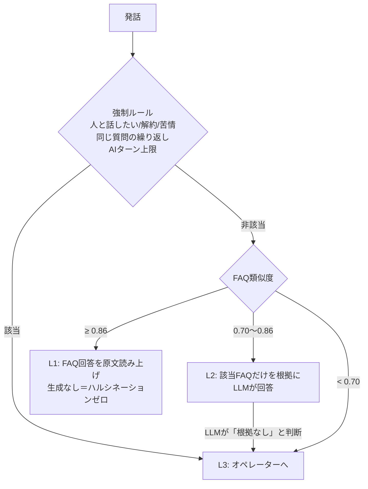

# AI Call Center with Ollama

**外部クラウドAIを一切使わない、自社完結型のAIコールセンター基盤（プロトタイプ）**

電話の音声を文字起こし → FAQ検索と社内LLMで回答 → 音声合成で応答し、AIで解決できない問い合わせは確実にオペレーターへ引き継ぎます。通話音声・会話内容が社外に出ないため、医療・金融・自治体など**データ主権が求められる業種**を想定しています。

> English: A self-hosted voice-bot platform for call centers. faster-whisper (STT) + Ollama (LLM) + VOICEVOX (TTS), RAG over tenant FAQs with multilingual-e5, a 3-layer escalation policy, PostgreSQL row-level-security multi-tenancy, and a Helm chart with NetworkPolicies that keep all AI traffic inside the cluster.

---

## 特長

| | 内容 | 実装 |
|---|---|---|
| 🔒 データ主権 | AIエンドポイントが外部を向いていると**起動を拒否**。K8s NetworkPolicyでモデルサーバーの外向き通信を遮断 | `config.py` / `networkpolicy.yaml` |
| 🧭 3層エスカレーション | ① FAQ原文読み上げ → ② FAQ根拠付きLLM回答 → ③ 有人対応。「人と話したい」「解約」等は即座に有人へ | `escalation.py` |
| 💬 続きの質問 | 直前の発話と合わせてFAQを検索し、直近の会話をLLMに渡すので「それは無料ですか」にも答えられる。前の話題のFAQを原文で読み上げることはしない | `escalation.py` |
| 📝 引き継ぎ要約 | 有人へ回すとき、用件の要約・エスカレーション理由・会話記録をオペレーター向けにまとめる。応答を返した後に生成するので発信者を待たせず、LLM失敗時も定型の要約で引き継ぐ。長い数字（カード番号等）は自動で伏せる | `handoff.py` / `GET .../handoff` |
| 📚 RAG FAQ | multilingual-e5（`query:` / `passage:` プレフィックス対応）でテナントごとに独立した索引 | `rag.py` |
| 🏢 マルチテナント | テナント単位の索引・セッション分離＋PostgreSQL RLSで他社データ参照を構造的に防止 | `tenants.py` / `db/schema.sql` |
| ⏱️ レイテンシ計測 | STT / 判定 / TTS の段階別ミリ秒をターンごとに記録、Prometheus形式で出力 | `pipeline.py` / `/metrics` |
| 💴 キャパシティ・コスト試算 | Erlang C でオペレーター数、同時通話数からGPU台数を算出し、1通話あたりコストを試算 | `cost_model.py` |

## アーキテクチャ



### 3層エスカレーションの判定順



設計上のポイント：
- **強制ルールを最優先**：FAQの一致度が高くても「人と話したい」と言った人をAIに留めない
- **L1は生成しない**：確度が高いときはLLMを通さず原文を読むので、誤回答リスクと遅延の両方を削減
- **続きの質問はL2で扱う**：「それは？」のように話題を含まない発話は、直前の発話と合わせて検索し、会話履歴付きでLLMが回答する。L1の原文読み上げは今の発話単体で一致したときだけ（`MAX_HISTORY_TURNS=0` で無効化）
- **L2は「わからない」と言える**：参考情報で答えられない場合は番兵文字列を返させ、推測回答を防止

## クイックスタート

```bash
# 1. 依存サービスを起動（Ollama / VOICEVOX / PostgreSQL / API）
cp .env.example .env
docker compose up -d
docker compose exec ollama ollama pull qwen2.5:7b-instruct

# 2. 通話を開始してテキストで1ターン試す
CALL=$(curl -s -X POST localhost:8000/v1/tenants/demo-clinic/calls | jq -r .call_id)
curl -s -X POST localhost:8000/v1/tenants/demo-clinic/calls/$CALL/text \
  -H 'Content-Type: application/json' -d '{"text":"駐車場はありますか"}' | jq

# 3. 音声で1ターン（応答はWAVで返る）
curl -s -X POST localhost:8000/v1/tenants/demo-clinic/calls/$CALL/audio \
  -F file=@question.wav -o reply.wav -D -
```

応答例：

```json
{
  "transcript": "駐車場はありますか",
  "reply": "建物の裏手に5台分の無料駐車場がございます。…",
  "layer": 1,
  "reason": "faq score 0.93",
  "sources": ["access-01"],
  "latency_ms": {"policy": 41.2, "tts": 310.5}
}
```

### オペレーターへの引き継ぎ要約

有人対応（layer 3）になったターンの応答には `handoff_url` が入ります（音声ターンでは `X-Handoff-Url` ヘッダー）。オペレーター画面はこのURLを取得します。

```bash
curl -s localhost:8000/v1/tenants/demo-clinic/calls/$CALL/handoff | jq
```

```json
{
  "status": "ready",
  "summary": "駐車場の有無を確認したうえで、解約を希望されています。",
  "reason": "hard rule matched: 解約",
  "last_utterance": "解約したいです",
  "transcript": [{"role": "caller", "text": "駐車場はありますか"}, {"role": "ai", "text": "建物の裏手に…"}],
  "faq_sources": ["access-01"],
  "generated_by": "llm"
}
```

要約の生成中は `{"status": "pending"}` が返ります。

### Kubernetes へのデプロイ

```bash
helm install cc deploy/helm/callcenter \
  --set ollama.model=qwen2.5:7b-instruct \
  --set api.replicas=3
```

GPUノード（`nvidia.com/gpu`）にOllamaを配置し、APIはHPAでCPU使用率に応じて2〜8台に自動スケールします。

## テスト

GPUやモデルなしで、通話フロー全体を数百ミリ秒で検証できるようにしています。STT/LLM/TTS/埋め込みはProtocolで抽象化し、テストでは決定的に動くダミーに差し替えています。

```bash
pip install -e ".[dev]"
pytest -q        # 42 tests
ruff check .
```

| テスト | 検証内容 |
|---|---|
| `test_escalation.py` | 各層への振り分け、強制ルールの優先、LLMの回答拒否、繰り返し・ターン上限での有人化、続きの質問・履歴の上限・通話間で履歴が混ざらないこと |
| `test_api.py` | テキスト/音声ターン、**テナント間でセッション・FAQが漏れないこと**、入力検証、メトリクス |
| `test_handoff.py` | 引き継ぎ要約の内容、LLM失敗時の代替要約、番号の伏せ字、テナント間で要約が見えないこと |
| `test_rag.py` | e5プレフィックス付与、類似度順の検索 |
| `test_cost_model_and_config.py` | Erlang Cの既知値、AI解決率とコストの関係、外部エンドポイント検出 |

## キャパシティ試算の例

```python
from callcenter.cost_model import Workload, estimate

estimate(Workload(peak_calls_per_hour=120, ai_resolution_rate=0.6))
# Estimate(gpus=2, operators=8, monthly_cost_jpy=3040000, monthly_calls=17640, cost_per_call_jpy=172.3)
```

AI解決率を30%→80%に改善した場合のオペレーター削減数とコスト差を、営業・導入提案の段階で数値で示せます。

## ディレクトリ構成

```
src/callcenter/
  adapters.py     STT / LLM / TTS クライアント（Protocolで差し替え可能）
  rag.py          FAQ読み込みとベクトル検索
  escalation.py   3層エスカレーション判定
  handoff.py      オペレーター向け引き継ぎ要約
  pipeline.py     音声1ターンの処理とレイテンシ計測
  tenants.py      テナント管理
  api.py          FastAPI エンドポイント
  cost_model.py   Erlang C ベースの体制・コスト試算
  config.py       環境変数とデータ主権ガード
db/schema.sql     マルチテナントスキーマ（pgvector + RLS）
deploy/helm/      Helm チャート（HPA・NetworkPolicy含む）
data/faq/         テナント別FAQ（サンプル: demo-clinic）
```

## 今後の拡張

- ストリーミングSTT／TTSによる応答開始までの遅延短縮（目標 < 1.5秒）
- 引き継ぎ要約を表示するオペレーター画面（APIは実装済み）
- FAQ未回答ログからの改善候補の自動抽出

## License

MIT
